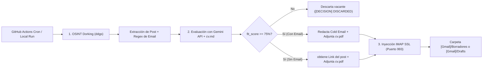

# 🤖 JobSeeker-aGeminiAgent — Autonomous OSINT & Gemini AI Job Hunter

Agente autónomo de Inteligencia Artificial en **Python 3.12** diseñado para descubrir publicaciones orgánicas de contratación en **LinkedIn** mediante técnicas OSINT, evaluar qué tanto se adapta cada vacante a tu perfil profesional utilizando la **API REST de Google Gemini**, y depositar borradores de contacto (**Cold Emails** o **Mensajes Directos de LinkedIn**) con tu **CV en PDF adjunto** directamente en tu bandeja de **Borradores de Gmail** vía **IMAP SSL**.

Opera bajo una filosofía estricta **Human-in-the-loop** y **Zero-Send Policy**: la IA automatiza el descubrimiento, filtrado y redacción personalizada, pero **jamás envía un correo por su cuenta** (el protocolo SMTP de envío no existe en el código). Tú siempre tienes la última palabra antes de hacer clic en *Enviar*.

---

## 📋 Tabla de Contenidos
1. [Arquitectura y Flujo de Ejecución](#-1-arquitectura-y-flujo-de-ejecución)
2. [Estructura del Proyecto](#-2-estructura-del-proyecto)
3. [Secretos y Variables de Entorno Requeridas](#-3-secretos-y-variables-de-entorno-requeridas)
4. [Guía de Personalización (CV, Búsqueda, Identidad y Horario)](#-4-guía-de-personalización-cv-búsqueda-identidad-y-horario)
5. [Cómo Utilizar y Ejecutar la Aplicación](#-5-cómo-utilizar-y-ejecutar-la-aplicación)
6. [Patrones de Resiliencia y Seguridad](#-6-patrones-de-resiliencia-y-seguridad)
7. [Sistema de Trazabilidad en Logs](#-7-sistema-de-trazabilidad-en-logs)

---

## 🧠 1. Arquitectura y Flujo de Ejecución



1. **Ingesta OSINT (`fetch_linkedin_posts`)**: Ejecuta *dorks* estructurados en DuckDuckGo (`site:linkedin.com/posts "we are hiring" <keywords> <location>`) mediante la librería `ddgs`, evitando bloqueos de IP y CAPTCHAs de LinkedIn. Extrae la URL del post, el fragmento de texto (*snippet*) y busca correos de reclutadores con expresiones regulares.
2. **Evaluación de Afinidad y Redacción (`generate_cold_email`)**: Cruza tu currículum en Markdown ([`cv.md`](cv.md)) contra el *snippet* de la vacante usando la API REST de Google Gemini y solicita una respuesta JSON estructurada:
   - `fit_score` (`1` a `100`): Nivel de coincidencia técnica con tu perfil.
   - `subject`: Asunto atractivo para el correo.
   - `body`:
     - Si el post incluye un correo electrónico: Redacta un **Cold Email** dirigido al reclutador.
     - Si el post **no** incluye correo: Redacta un **Mensaje Directo (DM)** corto y persuasivo listo para copiar y pegar en LinkedIn, y titula el borrador como `[LINKEDIN DM] Responder a: <URL>`.
3. **Inyección Nativa en Borradores de Gmail (`save_as_draft_with_pdf`)**: Si `fit_score >= 75`, construye un mensaje MIME estándar, adjunta físicamente tu [`cv.pdf`](cv.pdf) y lo guarda vía `imap.gmail.com:993` con las banderas `(\Draft \Seen)` en `[Gmail]/Borradores` (o `[Gmail]/Drafts` si la cuenta está en inglés).

---

## 📂 2. Estructura del Proyecto

```text
aGeminiAgentJobSeeker/
├── .antigravity/
│   ├── context-synthesizer.md         # Sintetizador de contexto por iteración y mapa de componentes
│   └── context_loader.md              # Especificación arquitectónica base (V1)
├── .github/
│   └── workflows/
│       └── daily.job.yml              # Pipeline de GitHub Actions (ejecución diaria por Cron + manual)
├── agent.py                           # Motor principal del agente (OSINT, Gemini REST, MIME e IMAP)
├── cv.md                              # Tu CV en texto/Markdown (usado por Gemini para evaluar y redactar)
├── cv.pdf                             # Tu CV en formato PDF (se adjunta físicamente al borrador de Gmail)
├── requirements.txt                   # Dependencias de Python (ddgs, requests, google-genai)
└── README.md                          # Manual de usuario y guía de configuración
```

---

## 🔐 3. Secretos y Variables de Entorno Requeridas

El agente nunca almacena credenciales en el código fuente. Necesita **3 variables de entorno** (o *GitHub Actions Secrets*):

| Variable / Secret | Descripción | Ejemplo |
| :--- | :--- | :--- |
| **`GEMINI_API_KEY`** | API Key de Google AI Studio para invocar los modelos Gemini. | `AIzaSyD...` |
| **`SMTP_USER`** | Tu dirección de correo de Gmail donde se guardarán los borradores. | `tu.correo@gmail.com` |
| **`SMTP_APP_PASSWORD`** | Contraseña de aplicación de Google de 16 caracteres (sin espacios o con espacios). **No uses tu contraseña normal de Gmail.** | `abcd efgh ijkl mnop` |

### Paso a paso para obtener tus credenciales

#### A. Obtener `GEMINI_API_KEY` (Gratis)
1. Ingresa a [Google AI Studio](https://aistudio.google.com/).
2. Haz clic en **Get API key** $\rightarrow$ **Create API key**.
3. Copia la clave generada y guárdala como `GEMINI_API_KEY`.

#### B. Obtener `SMTP_APP_PASSWORD` en Google Account
1. Asegúrate de tener activa la **Verificación en 2 pasos (2FA)** en tu [Cuenta de Google](https://myaccount.google.com/security).
2. Ve a **Seguridad** $\rightarrow$ busca **Contraseñas de aplicaciones** (*App Passwords*) o entra a `https://myaccount.google.com/apppasswords`.
3. Crea una nueva contraseña con el nombre `JobSeekerAgent`.
4. Google te mostrará un código de **16 letras**. Cópialo y úsalo como valor de `SMTP_APP_PASSWORD`.

#### C. Configurar los Secretos en GitHub Actions
1. En tu repositorio de GitHub, ve a **Settings** $\rightarrow$ **Secrets and variables** $\rightarrow$ **Actions**.
2. Haz clic en **New repository secret** y agrega uno por uno:
   - `GEMINI_API_KEY`
   - `SMTP_USER`
   - `SMTP_APP_PASSWORD`

---

## 🛠️ 4. Guía de Personalización (CV, Búsqueda, Identidad y Horario)

Si quieres adaptar el agente a un nuevo perfil, cambiar tecnologías de búsqueda o personalizar tu nombre, sigue esta lista:

### 1. Actualizar tu CV para la IA y para el Adjunto
Debes mantener sincronizados **ambos archivos** en la raíz del proyecto:
- **[`cv.md`](cv.md)**: Reemplaza su contenido con tu experiencia, stack tecnológico, certificaciones y logros en formato Markdown. **Este es el archivo que lee Gemini** para decidir el `fit_score` y redactar los argumentos de venta de tu perfil.
- **[`cv.pdf`](cv.pdf)**: Reemplaza este archivo por tu currículum actualizado en PDF manteniendo el nombre `cv.pdf`. **Este es el documento físico que se adjunta al borrador en Gmail.**

### 2. Cambiar el Nombre del Remitente y del Archivo Adjunto en [`agent.py`](agent.py)
Si deseas usar el agente con otro nombre de candidato, edita estas 4 líneas en [`agent.py`](agent.py):
- **Perfil de respaldo (`load_cv_markdown`, línea 40)**:
  ```python
  fallback_cv = "Tu Rol Principal (Tus Tecnologías Clave)."
  ```
- **Prompt del Agente y Plantilla Fallback (`generate_cold_email`, líneas 51 y 115–118)**:
  Actualiza el nombre en el prompt (`You are an autonomous AI Agent built by <Tu Nombre>`) y la firma del fallback estático.
- **Encabezado `From` y Nombre del PDF Adjunto (`save_as_draft_with_pdf`, líneas 129 y 137)**:
  ```python
  msg["From"] = f"Tu Nombre <{self.smtp_user}>"
  attachment_name = "Tu_Nombre_CV.pdf"
  ```

### 3. Cambiar Keywords, Ubicación, Límite de Posts y Fit Score Mínimo
Al final de [`agent.py`](agent.py) (en el bloque `if __name__ == "__main__":`, líneas 196–199), puedes ajustar directamente las constantes de ejecución:

```python
if __name__ == "__main__":
    SEARCH_KEYWORDS = "Java Spring Boot"  # Tecnologías o rol a buscar en LinkedIn
    SEARCH_LOCATION = "Mexico"            # País, ciudad o "Remote"
    SEARCH_LIMIT = 3                      # Cantidad máxima de posts a evaluar por corrida
    FIT_SCORE_THRESHOLD = 75              # Puntaje mínimo (1-100) para crear un borrador en Gmail
```

### 4. Cambiar la Frecuencia u Horario de Ejecución en [`.github/workflows/daily.job.yml`](.github/workflows/daily.job.yml)
Por defecto se ejecuta todos los días a las **08:00 AM UTC** (`02:00 AM CST`). Para modificarlo, edita la expresión cron en [`daily.job.yml`](.github/workflows/daily.job.yml):

```yaml
on:
  schedule:
    - cron: '0 14 * * 1-5' # Ejemplo: Lunes a Viernes a las 14:00 UTC (08:00 AM Ciudad de México)
  workflow_dispatch:
```

---

## 🚀 5. Cómo Utilizar y Ejecutar la Aplicación

### Opción A: Ejecución Automática o Manual en GitHub Actions (Recomendado)
1. Sube tus cambios (`cv.md`, `cv.pdf`, `agent.py`) a tu repositorio en GitHub.
2. Asegúrate de haber cargado los 3 secretos en **Settings $\rightarrow$ Secrets and variables $\rightarrow$ Actions**.
3. Para probarlo inmediatamente sin esperar al horario del Cron:
   - Ve a la pestaña **Actions** de tu repositorio.
   - Selecciona el workflow **LinkedIn AI Agent Daily Run** en el panel izquierdo.
   - Haz clic en el botón **Run workflow** $\rightarrow$ **Run workflow**.
4. Al finalizar, abre tu cuenta de Gmail y revisa la carpeta **Borradores (`Drafts`)**: encontrarás los correos redactados con tu PDF adjunto listos para revisar y enviar.

### Opción B: Ejecución en Local (Windows PowerShell / Linux / macOS)

1. **Crear entorno virtual e instalar dependencias**:
   ```powershell
   cd c:\dev\practice\aGeminiAgentJobSeeker
   python -m venv .venv
   .\.venv\Scripts\Activate.ps1
   pip install -r requirements.txt
   ```

2. **Definir variables de entorno y ejecutar (PowerShell)**:
   ```powershell
   $env:GEMINI_API_KEY="tu_api_key_de_gemini"
   $env:SMTP_USER="tu.correo@gmail.com"
   $env:SMTP_APP_PASSWORD="tu_app_password_de_16_digitos"

   python agent.py
   ```

   *(En Linux / macOS / Git Bash)*:
   ```bash
   export GEMINI_API_KEY="tu_api_key_de_gemini"
   export SMTP_USER="tu.correo@gmail.com"
   export SMTP_APP_PASSWORD="tu_app_password_de_16_digitos"

   python agent.py
   ```

---

## 🛡️ 6. Patrones de Resiliencia y Seguridad

- **Cascading Fallback (Degradación en Cascada)**:
  1. Intenta evaluar y redactar con `gemini-3.8-flash` (hasta 3 intentos).
  2. Si falla por cuota o saturación, conmuta automáticamente a `gemini-3.8-flash-8b` (hasta 3 intentos).
  3. Si ambos modelos fallan, activa una **plantilla estática de respaldo** con `fit_score: 85` para garantizar que ninguna vacante relevante se pierda.
- **Exponential Backoff & Timeouts**: Timeout HTTP estricto de `15s` por llamada a la API REST de Gemini, con pausas incrementales (`3s`, `6s`) entre reintentos.
- **Rate Limiting**: Pausa controlada de `5s` entre vacantes para respetar los límites de peticiones por minuto (RPM) de la capa gratuita de Gemini.
- **Fallback Bilingüe de Carpetas IMAP**: Intenta guardar primero en `"[Gmail]/Borradores"` y, si la cuenta está configurada en inglés, hace fallback automático a `"[Gmail]/Drafts"`.

---

## 📊 7. Sistema de Trazabilidad en Logs

Cada ejecución emite trazas estructuradas por etapa para auditar todo el proceso desde la consola o desde los logs de GitHub Actions:

| Etiqueta | Significado |
| :--- | :--- |
| `[INIT]` | Estado de inicialización del agente, usuario IMAP y verificación de variables de entorno. |
| `[CV]` | Confirmación de lectura de `cv.md` y cantidad de caracteres cargados en contexto. |
| `[OSINT]` / `[OSINT #N]` | Query exacta enviada a DuckDuckGo, URL del post de LinkedIn, correo extraído (`NONE` si no existe) y *snippet* completo. |
| `[EVAL i/N]` | Inicio de evaluación de la vacante `i` de `N`. |
| `[GEMINI]` | Modelo invocado, número de intento, código HTTP, latencia en segundos, `fit_score` calculado y asunto generado (o detalle del error HTTP). |
| `[DECISION i/N]` | Veredicto (`ACCEPTED` o `DISCARDED`), modo (`COLD_EMAIL` o `LINKEDIN_DM`), destinatario y cuerpo completo redactado. |
| `[MIME]` | Confirmación de adjuntado de `cv.pdf` con su tamaño en KB. |
| `[IMAP]` | Carpeta de Gmail utilizada, estado del comando `APPEND`, remitente, destinatario y asunto del borrador guardado. |
| `[SUMMARY]` | Métricas finales de la corrida: total de posts evaluados, borradores creados y vacantes descartadas. |
